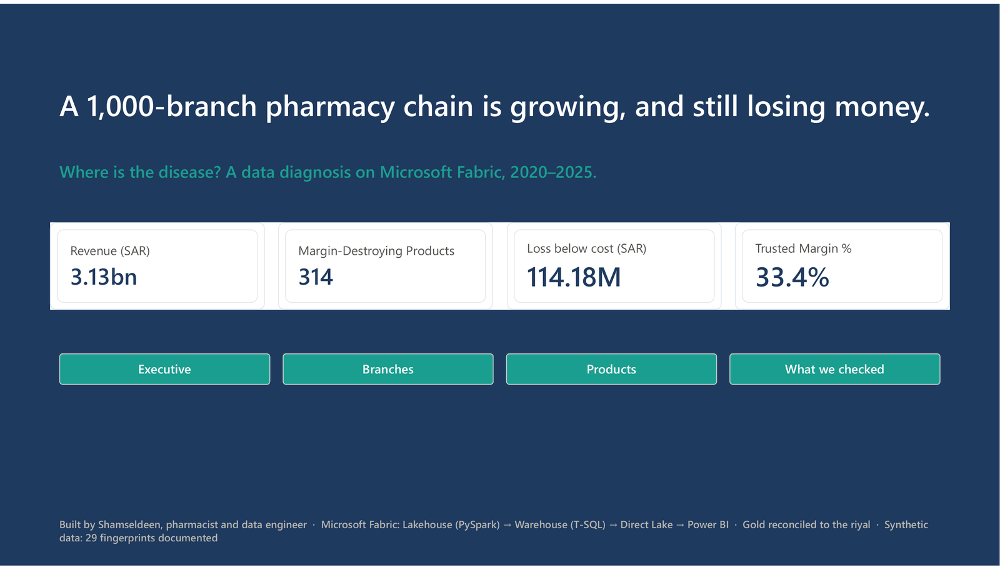
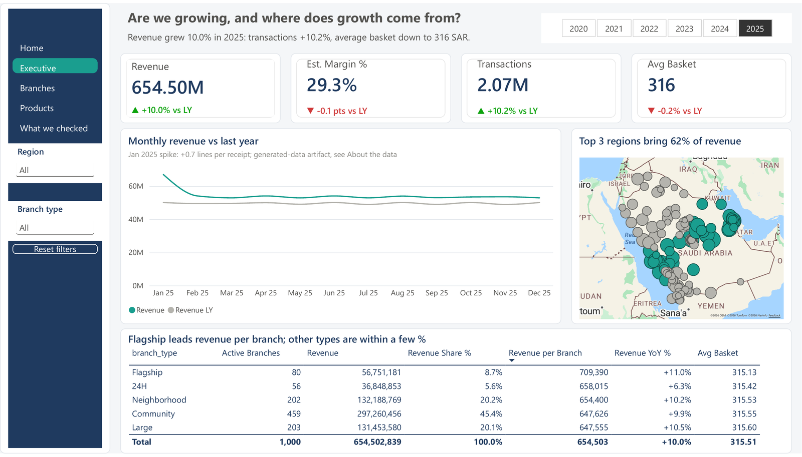
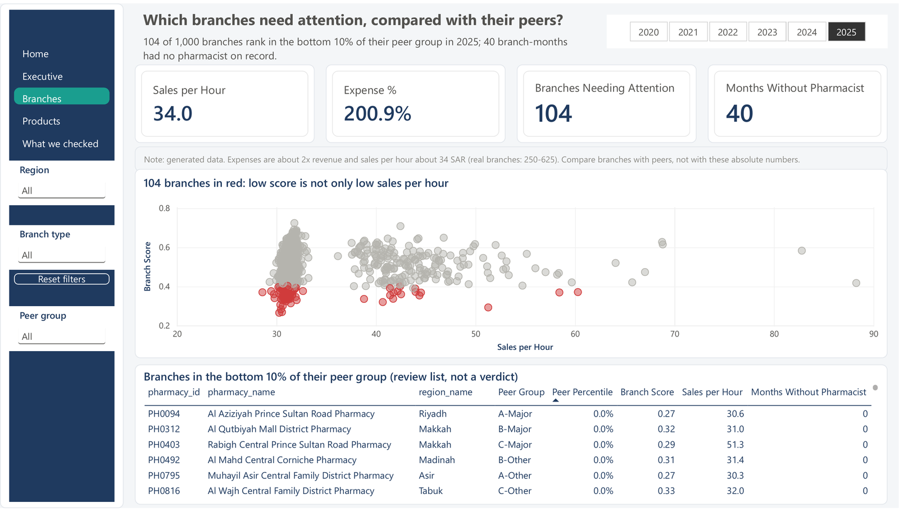
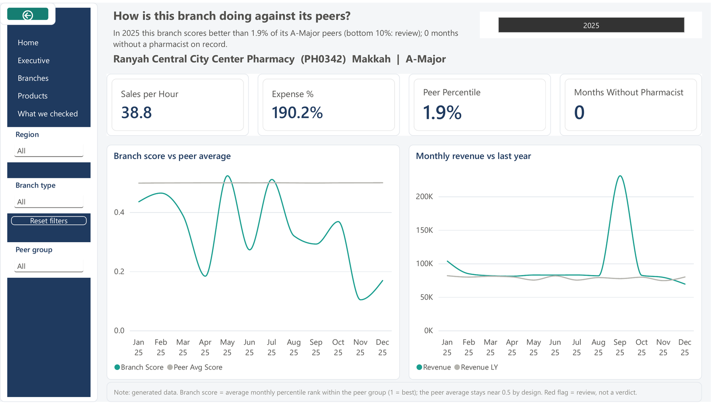
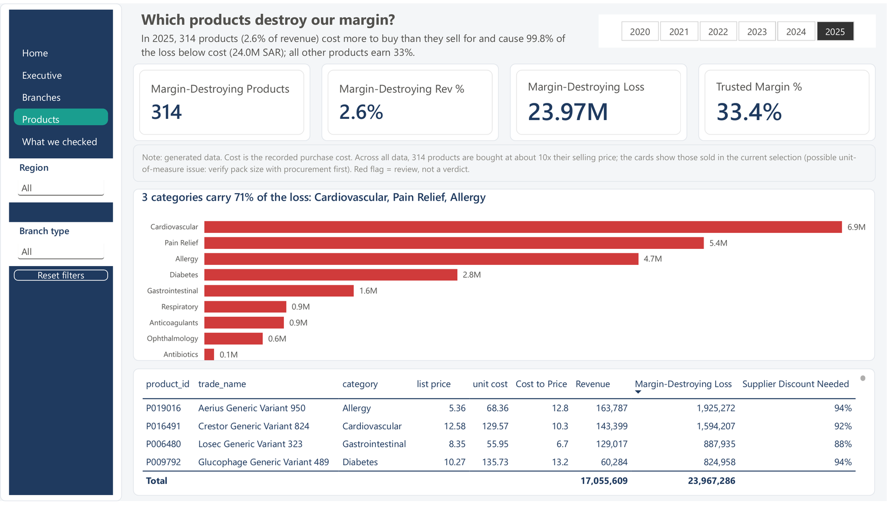
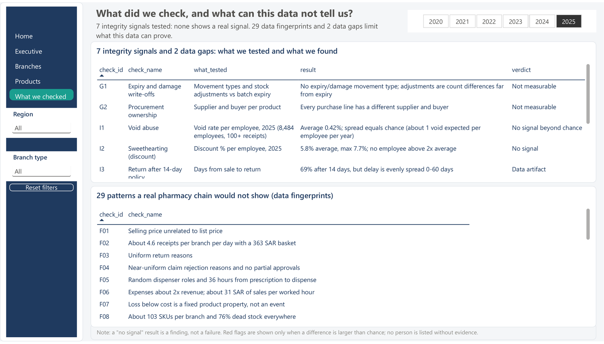
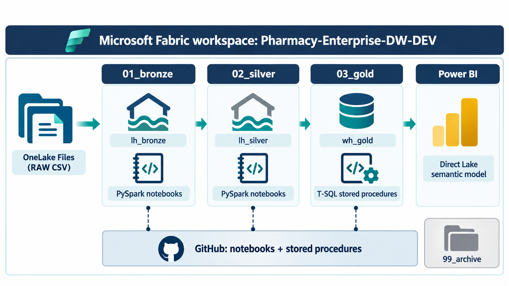

# 💊 Pharmacy Enterprise Data Warehouse

> **A 1,000-branch pharmacy chain is growing, and still losing money. Where is the disease?**

An end-to-end data diagnosis on **Microsoft Fabric**, built by a pharmacist turned data engineer.
Raw files → Lakehouse (PySpark) → Warehouse star schema (T-SQL) → Direct Lake semantic model → Power BI.
Synthetic Saudi chain: **1,000 pharmacies, 11 business domains, 2020–2025, 60 million rows.**




---

## 🩺 The story in one minute

The company called in a data analyst because it was bleeding money and nobody knew why.
The analyst worked like a surgeon: examine every organ, rule out the healthy ones, then point at the disease.

| Step | Page | Finding |
|---|---|---|
| 1 | **Executive** | The patient **looks healthy**: revenue grows about 10% a year. |
| 2 | **Branches** | **Branches are not the cause**: weakness is spread across peer groups, no region or type stands out. |
| 3 | **Products** | **The hidden tumour**: 314 products (2.6% of revenue) are bought at about **10x their selling price** and cause **99.8% of the loss below cost** (114M SAR over 2020–2025). Every other product earns **33%**. |
| 4 | **What we checked** | 7 integrity signals tested, **none shows a real signal**; 29 data fingerprints and 2 data gaps documented. |

> *Sales were growing, branches were working, and the company was still bleeding. The disease was not where everyone was looking.*

The analyst raises the red flag and brings the evidence; **the manager decides**. Every list in the report is labelled **"review, not a verdict"**.

---

## 📊 Dashboard

| Page | Question | Highlights |
|---|---|---|
| Home | Where is the disease? | 4 headline numbers, page buttons |
| Executive | Are we growing, and where does growth come from? | KPI cards vs last year, Saudi map (city bubbles, top-3 regions highlighted), branch-type table |
| Branches | Which branches need attention, compared with their peers? | Peer percentile, scatter (sales per hour × score), review list |
| Branch profile | How is this branch doing against its peers? | Drill-through: score vs peer average, revenue vs last year |
| Products | Which products destroy our margin? | Loss by category, action list with **supplier discount needed** to reach a 20% margin |
| What we checked | What can this data not tell us? | Integrity signals, data gaps, 29 fingerprints (from `gold.ref_data_checks`) |







**Design rules:** one question per page with a dynamic answer sentence, chart titles that state the finding (DAX, they change with filters), no pie or dual-axis charts, comparisons as arrow + sign + text, synced global slicers, Reset button, drill-through, performance checked (< 2 s per visual on a warm cache).

---

## 🏗️ Architecture



| Layer | Item | Result |
|---|---|---|
| **Bronze** | `lh_bronze` – 72 source tables | 60,234,021 rows, reconciled to raw (difference 0) |
| **Silver** | `lh_silver` – 58 cleaned tables | keys, types, money as `decimal(18,2)`, business-rule checks |
| **Gold** | `wh_gold` – 9 dimensions, 9 facts, 4 analytical tables | reconciled to the riyal |
| **Rebuild** | 23 stored procedures (`gold.usp_build_*`) | full Gold rebuild in about 2 minutes |
| **Model** | `sm_pharmacy_sales` – Direct Lake | measures in a `_Measures` table, written in TMDL |
| **Report** | `rpt_pharmacy_dashboard` | 6 pages + landing page |

**Reconciliation (Gold = facts = source):** revenue before VAT **3,126,598,408.75 SAR**, estimated margin **918,000,519.14 SAR (29.4%)**, expenses **6,799,713,291.35 SAR**.

---

## 🧠 Engineering and business decisions

- **VAT is not revenue.** Revenue = net before VAT.
- **Fair comparison:** branches are compared with peers (size band × region tier) on ratios, never totals.
- **Unknown ≠ zero:** a metric with no data, or with no variation inside a peer group, is left out of the score instead of counted as zero. *This rule found a real bug in Gold:* months without return data gave every branch a zero, and every score dropped by 0.1. Fixed and documented in the procedure.
- **Customer returns are not a performance metric.** A return is the customer's right; scoring pharmacists on it would push them to refuse returns. Returns are monitored for policy breaches only.
- **No invented metrics.** Expiry and damage are what a pharmacist should be accountable for, but the data has no write-off records. The report says so instead of building a fake indicator.
- **No accusation without evidence.** Buyers of loss-making products were compared with buyers of normal products (discount, turnover, leaving after purchase): no difference. The finding is a **missing control** (nothing stops buying above the selling price), not a person.
- **Keep source values, add corrected ones:** suspicious costs and opening dates are flagged, never overwritten.

---

## 🔍 Data quality: what the checks found

The dataset is synthetic. **29 generation fingerprints** were found and are documented in the report (`What we checked` page, table `gold.ref_data_checks`). Examples:

- every receipt has exactly 3 lines and every line exactly 2 units
- flat margin (33–34% trusted margin in every category) and no seasonality
- September 2025: the whole network's sales recorded in 203 of 1,000 branches
- no night sales, even in 24-hour branches
- expenses about 2x revenue

Because of these, the report uses **relative comparisons** (percentiles, shares, ratios) and avoids absolute market claims. They are also the requirements list for the next project: a realistic synthetic dataset.

---

## 🔁 Reproducibility

```sql
EXEC gold.usp_build_all;   -- calendar → dimensions → facts → analytical tables
```

Everything is in Git through Fabric Git integration: lakehouse notebooks, warehouse procedures, the semantic model (TMDL) and the report.

| Script | Purpose |
|---|---|
| `sql/utilities/extract_build_scripts_from_queryinsights.sql` | recover executed build scripts from the warehouse query history |
| `sql/utilities/generate_procedures_from_backup.sql` | generate one stored procedure per table |
| `sql/utilities/gold_rebuild_drill_reconciliation.sql` | rebuild drill with before / after reconciliation |

---

## 📁 Repository structure

```
fabric/                 synced with the Fabric workspace (Git integration)
  01_bronze/  02_silver/  03_gold/  04_reporting/  99_archive/
sql/utilities/          reusable SQL tools
docs/architecture/      diagrams
docs/dashboard/         report screenshots
```

---

## 🗺️ Next

1. **Project 2:** a realistic synthetic pharmacy dataset (expiry and damage write-offs, procurement ownership, seasonality, planted fraud cases to test the integrity signals)
2. Data Activator alerts
3. Later: AI on realistic data

---

## 👤 Author

**Shamseldeen** – pharmacist and operations manager in Saudi retail pharmacy, moving into data engineering.
Website: [shamsinsights.com](https://shamsinsights.com)

Licensed under the MIT License.
