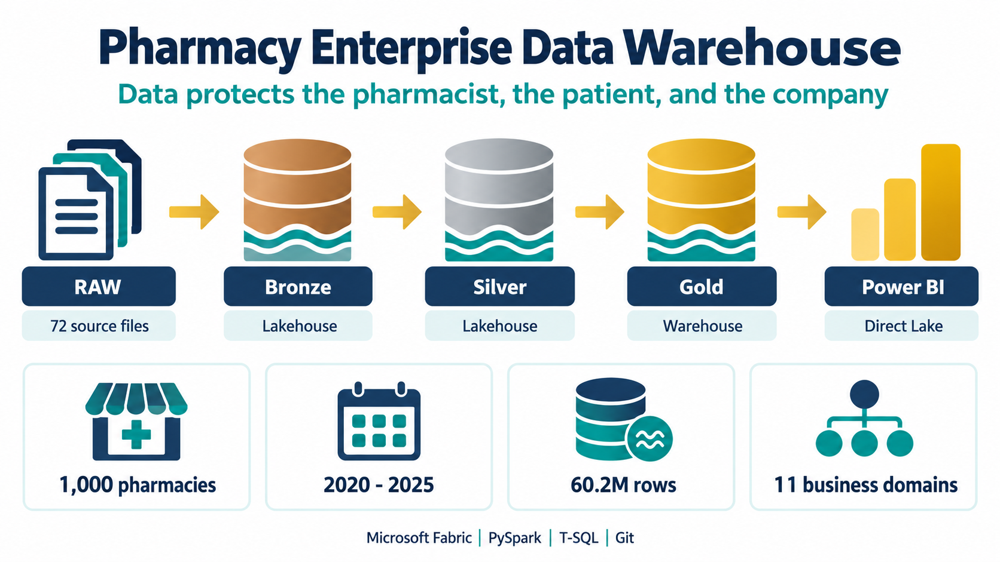
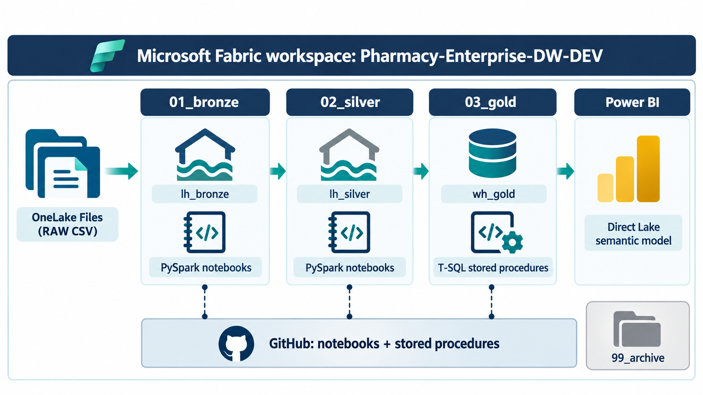
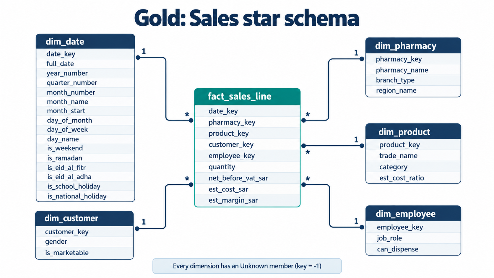
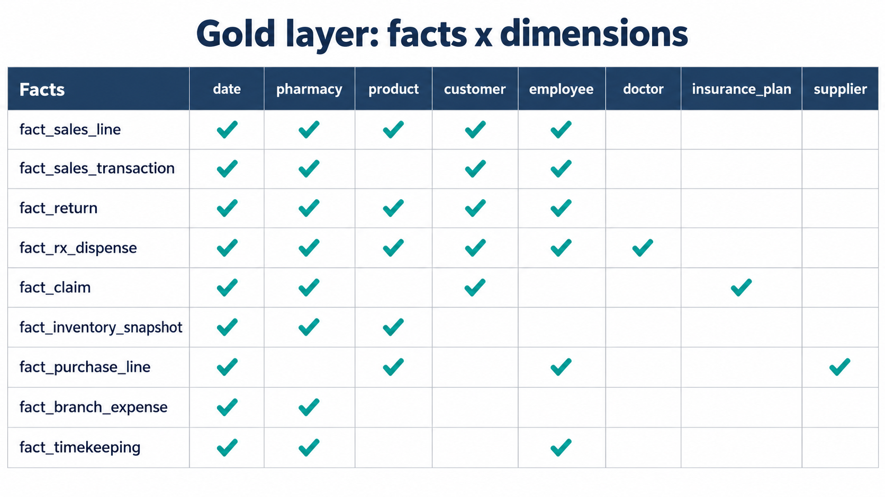
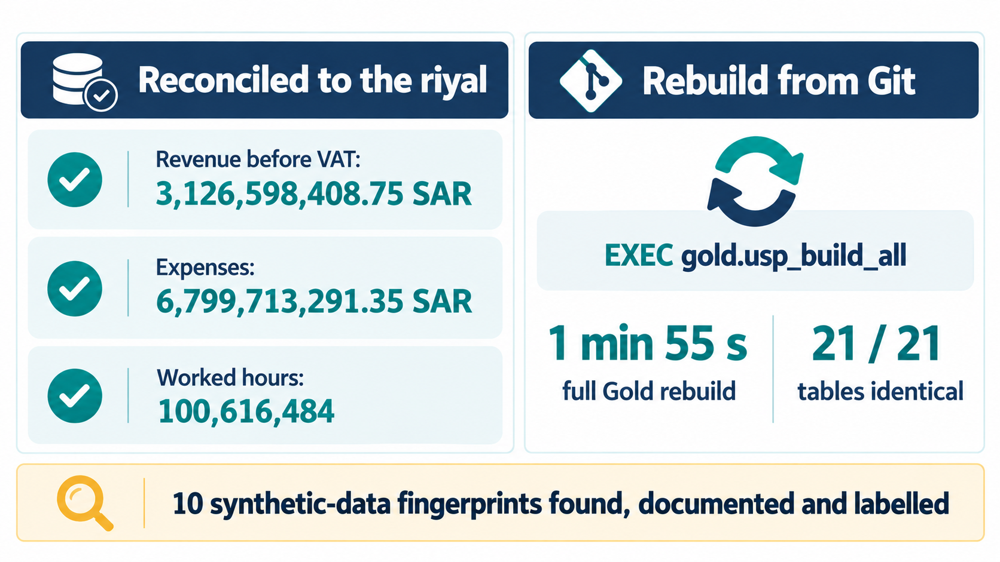

# 💊 Pharmacy Enterprise Data Warehouse

> **Data protects the pharmacist, the patient, and the company.**

An end-to-end retail-pharmacy data warehouse on **Microsoft Fabric**, built by a pharmacist turned data engineer.
It integrates 11 business domains (sales, prescriptions, insurance, inventory, procurement, suppliers, workforce, expenses, CRM, delivery, reference) for a synthetic Saudi chain of **1,000 pharmacies, 2020–2025**.




---

## 📌 Status (2026-10-25)

| Layer | Item | Result |
|---|---|---|
| **Bronze** | `lh_bronze` – 72 source tables | ✅ 60,234,021 rows, reconciled to RAW (difference 0) |
| **Silver** | `lh_silver` – 58 cleaned tables | ✅ keys, types, money as `decimal(18,2)`, business-rule checks |
| **Gold** | `wh_gold` – 9 dimensions, 9 facts, 3 analytical tables | ✅ reconciled to the riyal |
| **Rebuild** | 22 stored procedures (`gold.usp_build_*`) | ✅ full Gold rebuild in **1 min 55 s**, 21 / 21 tables identical |
| Semantic model & Power BI | Direct Lake, RLS | ⏳ next |
| AI | claim-rejection model, demand forecast | ⏳ planned |

---

## 🏗️ Architecture



| Fabric folder | Content |
|---|---|
| `01_bronze` | `lh_bronze`, `nb_01` reference exercise, `nb_02` ingestion framework |
| `02_silver` | `lh_silver`, `nb_04`–`nb_07b` core entities, `nb_10`–`nb_15` by domain (reference, POS, insurance, inventory, CRM, operations) |
| `03_gold` | `wh_gold` – tables, stored procedures, `usp_build_all` |
| `99_archive` | discovery contract (`nb_03`) and an abandoned metadata framework (`nb_08`, `nb_09`) |

---

## ⭐ Gold layer

**Dimensions:** `dim_date` (+ `ref_calendar_events`: Ramadan, Eid, national days), `dim_pharmacy`, `dim_product`, `dim_customer`, `dim_employee`, `dim_doctor`, `dim_insurance_plan`, `dim_supplier`
Every dimension has a surrogate key (`ROW_NUMBER` over the natural id, stable on rebuild) and an **Unknown member (-1)**.



**Facts:**

| Fact | Grain | Rows |
|---|---|---|
| `fact_sales_line` | sales line (completed sales) | 30,365,507 |
| `fact_sales_transaction` | receipt (all statuses) | 10,000,000 |
| `fact_return` | return line, linked to the original sale | 299,796 |
| `fact_rx_dispense` | prescription dispense | 173,913 |
| `fact_claim` | insurance claim (header amounts) | 75,000 |
| `fact_inventory_snapshot` | pharmacy × product × month | 325,412 |
| `fact_purchase_line` | purchase-order line (OTIF) | 82,140 |
| `fact_branch_expense` | pharmacy × expense category × month | 741,300 |
| `fact_timekeeping` | employee × month | 527,682 |




**Analytical tables:**

- `agg_product_loss_summary` – products sold below cost, cumulative loss, stock still on the shelf
- `agg_stock_aging_asof` – dead stock per pharmacy and a recommended action: `ROTATE` (demand exists in another branch), `SUPPLIER_DEAL`, `WATCH`, `OK`
- `agg_branch_scorecard_monthly` – branch KPIs ranked by **percentile within peer groups** (size band × region tier), ratios only, 1 = best

**Reconciliation (Gold = facts = source):** revenue before VAT **3,126,598,408.75 SAR**, estimated margin **918,000,519.14 SAR (29.4%)**, expenses **6,799,713,291.35 SAR**, worked hours **100,616,484**.

---

## 🧠 Engineering decisions

- **VAT is not revenue.** Revenue = net before VAT; a discount lowers margin, not cost.
- **Estimated cost** = gross amount × median batch cost ratio (category median as fallback). Products with a ratio below 0.30 or above 1.00 are **flagged, never altered** (`is_cost_ratio_suspicious`, 314 products) → a "trusted margin" filter in reports.
- **Fair comparison:** branches are compared with similar branches (previous-year size band × region tier), on ratios, not totals. Growth is ranked only for branches older than 24 months.
- **Unknown ≠ zero:** a month without recorded expenses gives `expense_pct = NULL`, and NULL metrics are excluded from ranking.
- **Keep source values, add corrected ones:** 297 pharmacies sell before their registered opening date → `effective_opening_date` is added, the source date is kept, and the conflict is flagged.
- **Safe dimension changes:** snapshot keys → rebuild → compare → drop the snapshot.
- **Human decisions are labelled as inferred:** the responsible pharmacist per month is estimated and marked `is_responsible_inferred`.

---

## 🔍 Data quality: what the checks found

The dataset is synthetic. The checks found **10 generation fingerprints** that a real chain would not show. They are documented, labelled in reports, and used as calibration for the next project:

1. Selling price unrelated to list price
2. About 4.6 receipts per branch per day with a 363 SAR basket (realistic: hundreds of receipts, 50–150 SAR)
3. Uniform return reasons
4. Near-uniform claim rejection reasons and no partial approvals
5. Random dispenser roles and 36 hours from prescription to dispense
6. Expenses about 2× revenue and about 31 SAR of sales per worked hour (realistic: 250–625 SAR per hour, expenses ≤ 30% of sales)
7. Loss is a fixed product property, not an event with a start and an end
8. About 103 SKUs per branch and 76% dead stock everywhere
9. No product without demand anywhere; weak Pareto
10. Branches selling before their registered opening date

Because of these, reports use **relative comparisons** (percentiles, structure, ratios) and avoid absolute market claims.

---

## 🔁 Reproducibility

The whole Gold layer is code in Git (`fabric/03_gold/wh_gold.Warehouse/gold/StoredProcedures/`):

```sql
EXEC gold.usp_build_all;   -- calendar → dimensions → facts → analytical tables
```

Disaster-recovery drill (2026-10-24): all Gold tables rebuilt in 1 min 55 s; row counts and money totals identical for 21 / 21 tables.



Utilities in [`sql/utilities`](sql/utilities):

| Script | Purpose |
|---|---|
| `extract_build_scripts_from_queryinsights.sql` | recover executed build scripts from the warehouse query history |
| `generate_procedures_from_backup.sql` | generate one stored procedure per table (dynamic SQL) |
| `gold_rebuild_drill_reconciliation.sql` | rebuild drill with before / after reconciliation |

---

## 📁 Repository structure

```
fabric/                 synced with the Fabric workspace (Git integration)
  01_bronze/  02_silver/  03_gold/  99_archive/
sql/utilities/          reusable SQL tools
archive/sql_server/     first version on SQL Server (history only)
docs/architecture/      verified diagrams
```

---

## 🗺️ Roadmap

1. Semantic model on Direct Lake, measures, row-level security
2. Power BI dashboard (executive, branch scorecard, inventory, insurance, maps)
3. Data Activator alerts (e.g. a branch with no pharmacist on duty)
4. AI: insurance-claim rejection model, then demand forecasting
5. **Project 2:** a realistic synthetic dataset generated inside Fabric, calibrated with the lessons above

---

## 👤 Author

**Shamseldeen** – pharmacist and operations manager in Saudi retail pharmacy, moving into data engineering.
Website: [shamsinsights.com](https://shamsinsights.com)

Licensed under the MIT License.
