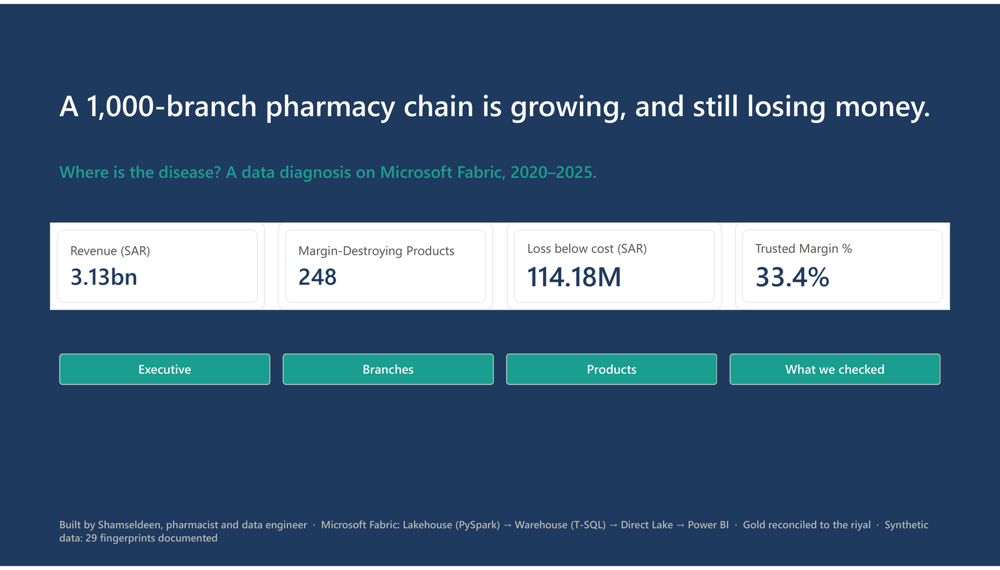
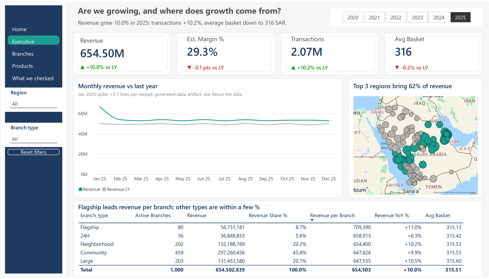
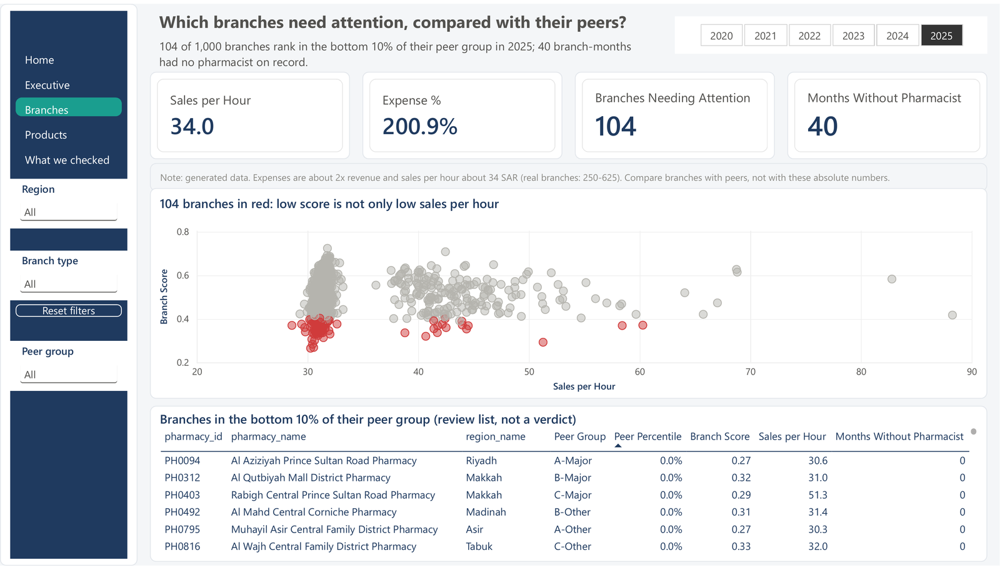
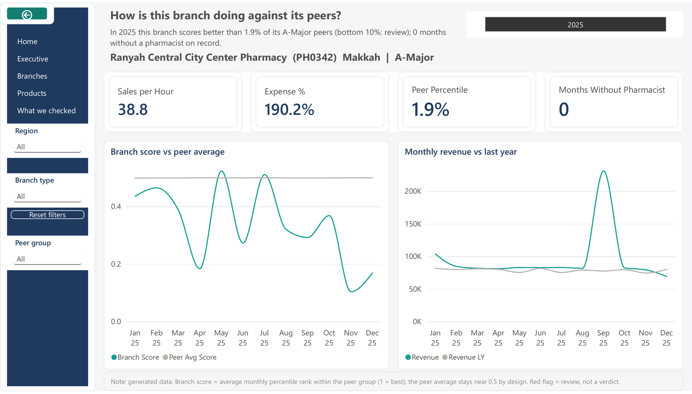
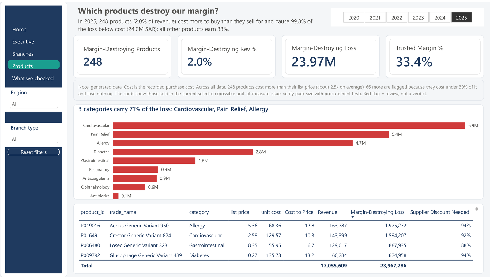
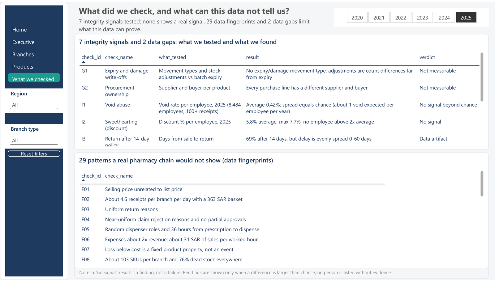
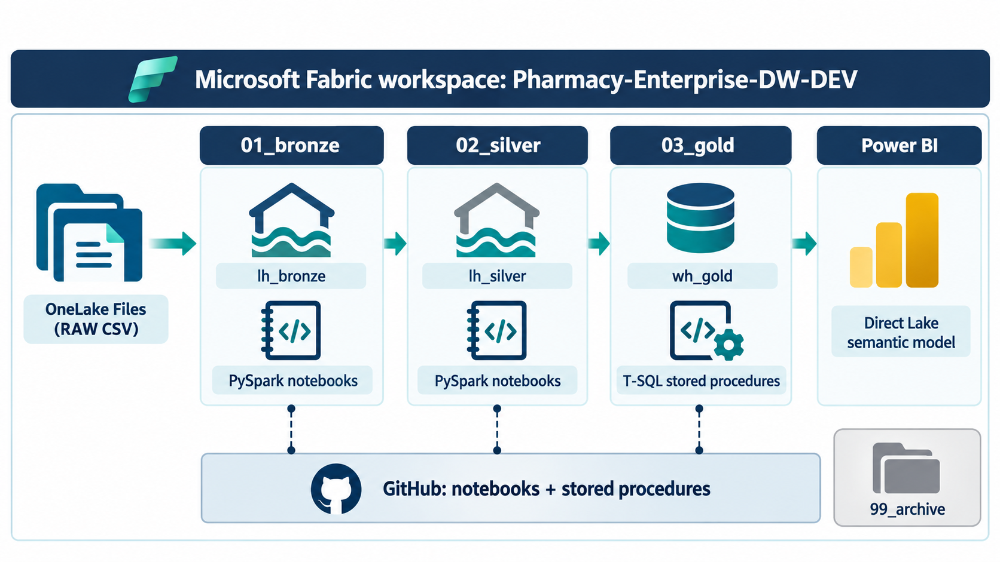
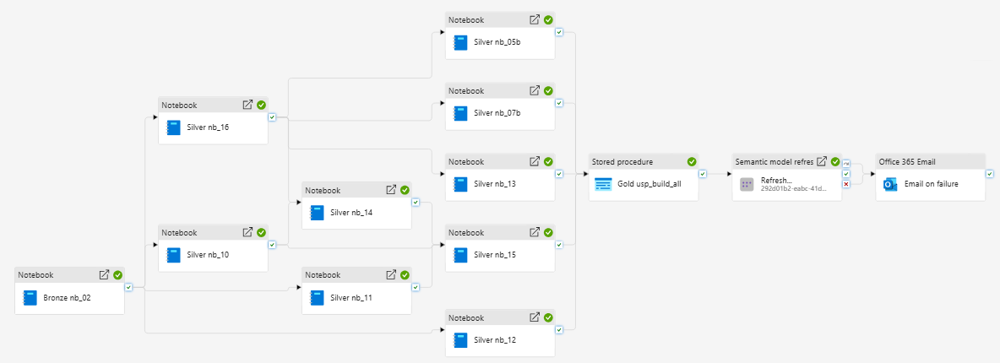
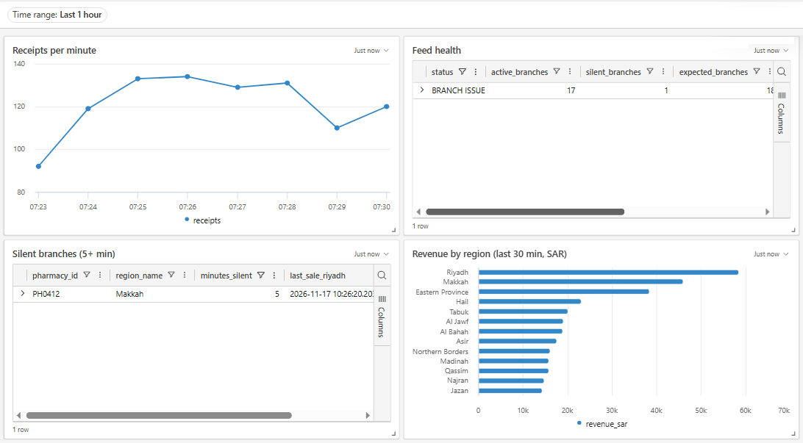
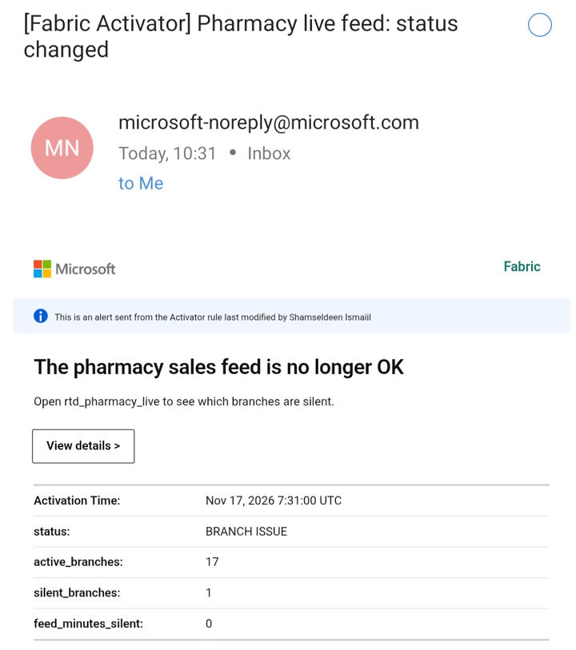

# 💊 Pharmacy Enterprise Data Warehouse

> **A 1,000-branch pharmacy chain is growing, and still losing money. Where is the disease?**

An end-to-end data diagnosis on **Microsoft Fabric**, built by a pharmacist turned data engineer.
Raw files → Lakehouse (PySpark) → Warehouse star schema (T-SQL) → Direct Lake semantic model → Power BI.
Synthetic Saudi chain: **1,000 pharmacies, 11 business domains, 2020–2025, 60 million rows.**




**▶ Explore it yourself:** [interactive dashboard on shamsinsights.com](https://shamsinsights.com/pharmacy-dashboard.html) (English · [العربية](https://shamsinsights.com/pharmacy-dashboard-ar.html)). Filter by year and region, find the branches to review and search the products sold below cost. It is built from six Gold aggregates exported by `nb_90_export_gold_for_web`, so it stays online without a Fabric capacity.

---

## 🩺 The story in one minute

The company called in a data analyst because it was bleeding money and nobody knew why.
The analyst worked like a surgeon: examine every organ, rule out the healthy ones, then point at the disease.

| Step | Page | Finding |
|---|---|---|
| 1 | **Executive** | The patient **looks healthy**: revenue grows about 10% a year. |
| 2 | **Branches** | **Branches are not the cause**: weakness is spread across peer groups, no region or type stands out. |
| 3 | **Products** | **The hidden tumour**: 248 products (2% of revenue) are bought above their list price (**about 2.5x on average**) and cause **99.8% of the loss below cost** (114M SAR over 2020–2025). The report flags 314 products with an unusual cost ratio: these 248 plus 66 that cost under 30% of list price and lose nothing. Every other product earns **33%**. |
| 4 | **What we checked** | 7 integrity signals tested, **none shows a real signal**; 29 data fingerprints and 2 data gaps documented. |

> *Sales were growing, branches were working, and the company was still bleeding. The disease was not where everyone was looking.*

The analyst raises the red flag and brings the evidence; **the manager decides**. Every list in the report is labelled **"review, not a verdict"**.

---

## 📊 Dashboard

| Page | Question | Highlights |
|---|---|---|
| Home | Where is the disease? | 4 headline numbers, page buttons |
| Executive | Are we growing, and where does growth come from? | KPI cards vs last year, Saudi map (city bubbles, top-3 regions highlighted), branch-type table |
| Branches | Which branches need attention, compared with their peers? | Peer percentile, scatter (sales per hour × score), review list |
| Branch profile | How is this branch doing against its peers? | Drill-through: score vs peer average, revenue vs last year |
| Products | Which products destroy our margin? | Loss by category, action list with **supplier discount needed** to reach a 20% margin |
| What we checked | What can this data not tell us? | Integrity signals, data gaps, 29 fingerprints (from `gold.ref_data_checks`) |







**Design rules:** one question per page with a dynamic answer sentence, chart titles that state the finding (DAX, they change with filters), no pie or dual-axis charts, comparisons as arrow + sign + text, synced global slicers, Reset button, drill-through, performance checked (< 2 s per visual on a warm cache).

---

## 🏗️ Architecture



| Layer | Item | Result |
|---|---|---|
| **Bronze** | `lh_bronze` – 72 source tables | 60,234,021 rows, reconciled to raw (difference 0) |
| **Silver** | `lh_silver` – 58 cleaned tables | keys, types, money as `decimal(18,2)`, business-rule checks |
| **Gold** | `wh_gold` – 9 dimensions, 9 facts, 4 analytical tables | reconciled to the riyal |
| **Rebuild** | 23 stored procedures (`gold.usp_build_*`) | full Gold rebuild in about 2 minutes |
| **Model** | `sm_pharmacy_sales` – Direct Lake | measures in a `_Measures` table, written in TMDL |
| **Report** | `rpt_pharmacy_dashboard` | 6 pages + landing page |
| **Web export** | `nb_90_export_gold_for_web` | 6 Gold aggregates to CSV for the [public web dashboard](https://shamsinsights.com/pharmacy-dashboard.html); totals reconcile to the riyal |
| **Orchestration** | `pl_pharmacy_daily_build` – Data Pipeline | Bronze → Silver → Gold → model refresh, scheduled, about 36 minutes |

**Reconciliation (Gold = facts = source):** revenue before VAT **3,126,598,408.75 SAR**, estimated margin **918,000,519.14 SAR (29.4%)**, expenses **6,799,713,291.35 SAR**.

---

## 🧠 Engineering and business decisions

- **VAT is not revenue.** Revenue = net before VAT.
- **Fair comparison:** branches are compared with peers (size band × region tier) on ratios, never totals.
- **Unknown ≠ zero:** a metric with no data, or with no variation inside a peer group, is left out of the score instead of counted as zero. *This rule found a real bug in Gold:* months without return data gave every branch a zero, and every score dropped by 0.1. Fixed and documented in the procedure.
- **Customer returns are not a performance metric.** A return is the customer's right; scoring pharmacists on it would push them to refuse returns. Returns are monitored for policy breaches only.
- **No invented metrics.** Expiry and damage are what a pharmacist should be accountable for, but the data has no write-off records. The report says so instead of building a fake indicator.
- **No accusation without evidence.** Buyers of loss-making products were compared with buyers of normal products (discount, turnover, leaving after purchase): no difference. The finding is a **missing control** (nothing stops buying above the selling price), not a person.
- **Keep source values, add corrected ones:** suspicious costs and opening dates are flagged, never overwritten.

---

## 🔍 Data quality: what the checks found

The dataset is synthetic. **29 generation fingerprints** were found and are documented in the report (`What we checked` page, table `gold.ref_data_checks`). Examples:

- every receipt has exactly 3 lines and every line exactly 2 units
- flat margin (33–34% trusted margin in every category) and no seasonality
- September 2025: the whole network's sales recorded in 203 of 1,000 branches
- no night sales, even in 24-hour branches
- expenses about 2x revenue

Because of these, the report uses **relative comparisons** (percentiles, shares, ratios) and avoids absolute market claims. They are also the requirements list for the next project: a realistic synthetic dataset.

---

## ⚙️ Orchestration: one pipeline runs everything



`pl_pharmacy_daily_build` rebuilds the whole platform with no manual step. It runs on schedule at 03:00 (Riyadh) and succeeded on 11, 12 and 13 November 2026.

| Step | Activity | Waits for |
|---|---|---|
| 1. Bronze | `nb_02` loads the 72 source files | — |
| 1b. Wait | 180 s, so the Bronze Spark session releases capacity | Bronze |
| 2. Silver, layer 1 | `nb_16`, `nb_10`, `nb_11`, `nb_12` in parallel | Wait |
| 3. Silver, layer 2 | `nb_05b`, `nb_07b`, `nb_13` · `nb_14` · then `nb_15` | only the tables each one reads |
| 4. Gold | stored procedure `gold.usp_build_all` | the last Silver notebooks |
| 5. Model | refresh of `sm_pharmacy_sales` | Gold |
| 6. Alert | failure email | the refresh **failed or was skipped** |

**Run of 12 Nov 2026:** 36 minutes in total (Bronze 18 min, Silver about 13 min, Gold 2 min 40 s, refresh 39 s).

**Design rules**

- **Dependencies, not a chain:** each notebook waits only for the notebooks whose tables it reads, so independent work runs in parallel.
- **Safe to rerun:** every notebook writes with `overwrite`, so a retry or a *Rerun from failed activity* gives the same result. Four Silver tables were first built by one-time notebooks (`errorifexists`); `nb_16_silver_core_rebuild` replaced them for the pipeline.
- **Fail loudly:** a gate cell at the end of `nb_02` raises an error if any source failed. Without it, `try/except` would hide the failure and Silver would be built on incomplete data.
- **One alert, not fourteen:** the alert hangs off the last step with *On failure* and *On skip*, so any failure anywhere reaches it.

**What broke on the way, and the fix**

| Problem | Cause | Fix |
|---|---|---|
| A Bronze notebook failed | two notebooks wrote the same Delta table at the same time | removed the duplicate notebook from the pipeline |
| Silver notebooks failed after 20 s (HTTP 430) | parallel Spark sessions hit the trial capacity limit | high-concurrency sessions with one session tag, smaller Spark pool (1–3 nodes), retry 2 × 180 s |
| A notebook passed cell by cell but failed in the pipeline | an old exploration cell used a renamed column | turned into a Markdown note with the finding |
| Failure email not delivered | the Outlook activity needs an Exchange Online mailbox; the trial account has none | failure path proven to trigger; built-in schedule failure notifications set as a second channel |

*Follow-up fix (13 Nov 2026):* the first Silver attempt kept failing every night and passing on retry, because the Bronze Spark session holds capacity for about two minutes after it ends. A 180-second *Wait* activity after Bronze replaced the failure: the next run had 13 activities, all succeeded on the first attempt, same 36 minutes.

## ⚡ Real-time: know within minutes when a branch stops selling



The nightly pipeline answers *what happened yesterday*. This slice answers *is every branch selling right now?* A branch with no receipt for 10 minutes during opening hours usually means the point-of-sale system is down, the network is cut, or the branch closed without notice.

| Step | Item | What it does |
|---|---|---|
| 1. Source | `nb_20_live_sales_simulator` | sends receipts from 18 real branches (at least one per region) every 5 s, about 120 a minute; branch `PH0412` (Makkah) stops after 3 minutes on purpose |
| 2. Stream | `es_pharmacy_sales` (Eventstream) | custom endpoint → Eventhouse, direct ingestion |
| 3. Store | `eh_pharmacy_live` (Eventhouse, KQL) | table `live_sales` with a JSON ingestion mapping written in KQL, not clicked |
| 4. Logic | `fn_silent_branches`, `fn_feed_health` | KQL functions: which branches are silent, and one status for the whole feed |
| 5. View | `rtd_pharmacy_live` (Real-Time Dashboard) | 4 tiles, auto refresh every 30 s |
| 6. Alert | `act_pharmacy_live` (Activator) | checks `fn_feed_health` every 5 min and emails when the status changes from OK |

**One silent branch is not the same as a silent feed.** If all 18 branches stop at the same minute, the problem is the source or the stream, not 18 branches. `fn_feed_health` returns one status, so the manager gets one alert instead of eighteen:

| Status | Rule | Who acts |
|---|---|---|
| OK | every branch sold in the last N minutes | nobody |
| BRANCH ISSUE | one or a few branches silent | the area supervisor calls the branch |
| FEED DEGRADED | more than half the branches silent | IT checks the network |
| FEED DOWN | no receipt from any branch in N minutes | data team checks the source and the stream |

**The alert, as received** (17 Nov 2026, 10:31 Riyadh time, in the same minute the dashboard turned to BRANCH ISSUE):



**Design rules**

- **Alert on change, not on state:** the rule fires when the status *changes from OK*, so a feed that stays down for an hour sends one email, not twelve.
- **No secret in Git:** the Eventstream connection string lives in `lh_silver/Files/secrets/` (lakehouse files are not synced to Git); the notebook reads it at run time.
- **Check the event shape before sending:** a missing or renamed field would land as an empty column without any error, so the simulator compares every event with the mapping first.
- **Rebuild from Git:** the table, mapping and both functions are stored in `DatabaseSchema.kql` with `create-merge` / `create-or-alter`, so they can be applied again safely.

**What broke on the way, and the fix**

| Problem | Cause | Fix |
|---|---|---|
| The first test kept only 58 of about 1,200 receipts | the data connection was created after the simulator started; it does not read events sent before it existed | create the connection first, then start the source |
| The last minute on the chart always dropped | the current minute is still filling (partial bin) | count only finished minutes: `event_time >= bin(ago(30m),1m) and event_time < bin(now(),1m)` |
| Every branch looked silent after a test | the simulator had stopped, so all 18 went quiet at once | `fn_feed_health` reports FEED DOWN instead of 18 branch alerts |
| KQL syntax error | `latest` is a reserved word in KQL | renamed the column |

*Times on the dashboard chart are UTC; the silent-branch table shows Riyadh time.*

---

## 🔁 Reproducibility

```sql
EXEC gold.usp_build_all;   -- calendar → dimensions → facts → analytical tables
```

Or run the whole platform with the `pl_pharmacy_daily_build` pipeline (see Orchestration above).

Everything is in Git through Fabric Git integration: lakehouse notebooks, warehouse procedures, the semantic model (TMDL) and the report.

| Script | Purpose |
|---|---|
| `sql/utilities/extract_build_scripts_from_queryinsights.sql` | recover executed build scripts from the warehouse query history |
| `sql/utilities/generate_procedures_from_backup.sql` | generate one stored procedure per table |
| `sql/utilities/gold_rebuild_drill_reconciliation.sql` | rebuild drill with before / after reconciliation |

---

## 📁 Repository structure

```
fabric/                 synced with the Fabric workspace (Git integration)
  01_bronze/  02_silver/  03_gold/  04_reporting/  05_orchestration/  06_realtime/  99_archive/
sql/utilities/          reusable SQL tools
docs/architecture/      diagrams
docs/dashboard/         report screenshots
docs/pipeline/          pipeline run screenshot
docs/realtime/          real-time dashboard and alert screenshots
docs/                   data catalog and naming conventions
```

**Documentation**
- [Data catalog](docs/data_catalog.md): all 22 Gold tables, with grain, purpose and columns
- [Naming conventions](docs/naming_conventions.md): naming rules from Fabric items down to column names

---

## 🗺️ Next

1. **Project 2 (separate repo, Databricks):** an online pharmacy with realistic synthetic data, live orders and insurance pre-authorization
2. Later: AI on realistic data

---

## 👤 Author

**Shamseldeen** – pharmacist-in-charge in Saudi retail pharmacy (11+ years), moving into data engineering.
Website: [shamsinsights.com](https://shamsinsights.com)

Licensed under the MIT License.
